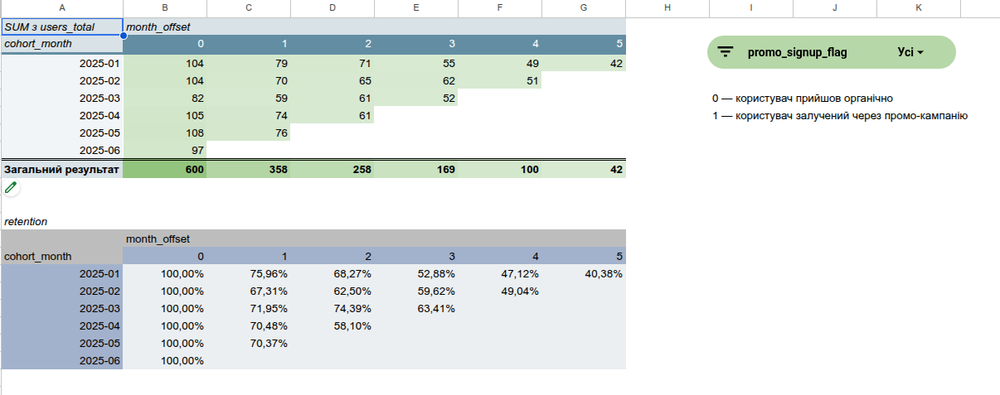
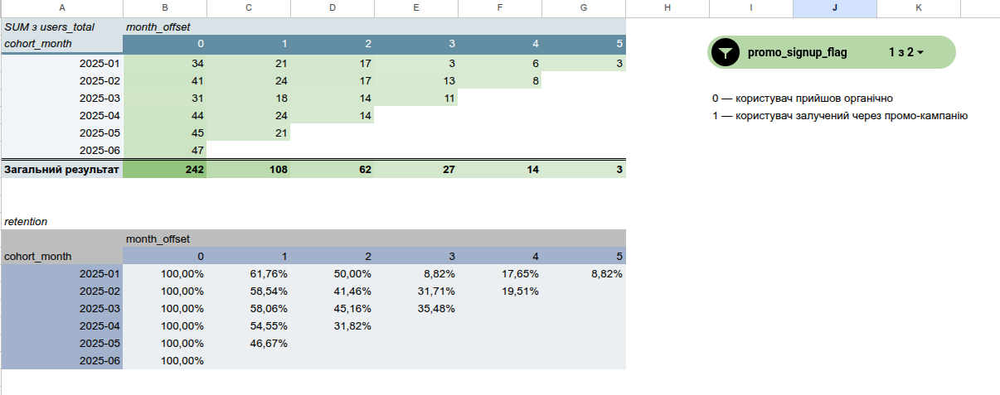
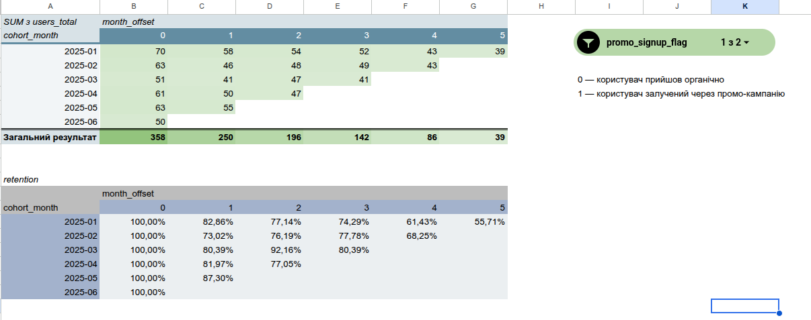

# User-Retention-Cohort-Analysis
User retention analysis using SQL and monthly cohort analysis.

Project Overview:
This project focuses on analyzing user retention through monthly cohort analysis.
The goal is to understand how user engagement changes over time, identify retention patterns across cohorts, and compare user activity based on promotional status.

Business Objectives:
- Identify monthly user cohorts based on their first activity.
- Analyze user retention across promotional and organic acquisition segments.
- Compare retention patterns based on promotional status.
- Calculate monthly user retention rates.
- Visualize user retention trends using interactive cohort tables.

Tools & Technologies:
- PostgreSQL — data extraction, joining tables, and data preparation.
- DBeaver — SQL development and query execution.
- Google Sheets — cohort calculations, retention analysis, and visualization.

Analysis Process:
- Extracting and combining data from multiple database tables using SQL.
- Preparing a dataset for cohort analysis.
- Exporting prepared data to Google Sheets.
- Building interactive cohort tables.
- Calculating and visualizing monthly user retention rates.
- Comparing retention patterns across promotional and organic user segments.
 
## Project Visualization
### User Retention Cohort Table

### Promo Users

### Organic Users

## Key Findings.
- Analyzed and compared user retention across two segments: Promo Users (acquired through promotional campaigns and paid advertising) and Organic Users.
- Identified lower retention among promo-acquired users, suggesting that users acquired through promotional campaigns are less likely to remain active over time.
- This finding may indicate opportunities to improve promotional campaign effectiveness and attract users with stronger long-term engagement.
